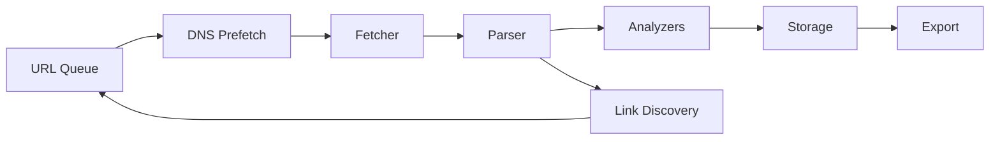

Crawlkit's documentation renders Mermaid diagrams with
[Pele](https://pele.run) — a small, synchronous renderer with no runtime
dependencies and CSS-variable theming.

The loader is injected automatically on pages that contain diagrams;
colors follow the site theme via CSS variables.
